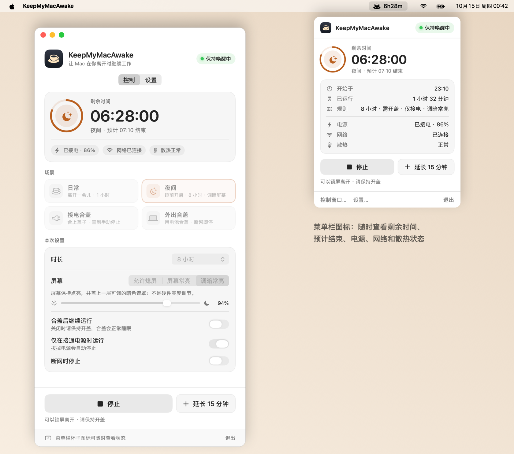

<h1 align="center">KeepMyMacAwake</h1>

<p align="center">
  <b>Keep your Mac working while you're away.</b><br>
  Your AI coding agent, build or download is still running? Lock the screen, go to sleep, even close the lid — your Mac stays awake, then returns to normal sleep when time is up.
</p>

<p align="center">
  <a href="https://github.com/diguike/KeepMyMacAwake/releases">Download for Mac</a> ·
  <a href="README.md">中文</a> ·
  Native macOS menu bar app · Free and open source (MIT)
</p>

<p align="center">
  <picture>
    <source media="(prefers-color-scheme: dark)" srcset="docs/images/overview-dark.png">
    
  </picture>
</p>

> The interface is currently in Simplified Chinese. An English UI is not available yet.

## Why

You ask Claude Code, Codex or Cursor to run a long refactor or test suite, or start a large download, then step away for lunch, a meeting or the night. When you come back, the Mac fell asleep and the task stopped halfway.

KeepMyMacAwake turns "don't let the Mac sleep" into one button: pick a scene, press start. When the time is up it ends by itself and the Mac sleeps normally again — no settings to remember to revert, no `caffeinate` in a terminal.

## Features

- **One-click keep-awake** for 30 minutes, 1/2/8 hours, a custom 1–1440 minutes, or until you stop it; extend by 15 minutes at any time.
- **Menu bar status panel**: remaining time, expected end, elapsed time, power and battery, network, thermal state and the last session's end reason — plus start, stop and extend.
- **Lock the screen and leave**: lock-screen rules are untouched.
- **Keep running with the lid closed** after a one-time approval of the background component, on power or on battery.
- **Three screen modes**: let the display sleep, keep it on, or keep it on and dimmed for the night.
- **Automatic stop conditions**: unplugged power, battery at your limit, high thermal pressure, network loss (optional), or when these states cannot be read.
- **Reliable recovery**: the closed-lid sleep setting is owned by an independent helper that restores it if the app quits, crashes or stops responding for 20 seconds.
- **Last result**: see when and why last night's session ended.
- **Local only**: no telemetry; only your preferences and the most recent result are stored on your Mac.

| Scene | Defaults |
| --- | --- |
| 日常 Daily | 1 hour · lid open · power only · display may sleep |
| 夜间 Night | 8 hours · lid open · power only · dimmed display |
| 接电合盖 Lid closed on power | until stopped · lid closed · power only |
| 外出合盖 Lid closed on the go | 2 hours · lid closed · battery allowed · stops on network loss |

## Install

1. Download the latest `KeepMyMacAwake-…-macOS-universal.dmg` from [Releases](https://github.com/diguike/KeepMyMacAwake/releases) (macOS 14+, Apple Silicon and Intel).
2. Drag KeepMyMacAwake into Applications and open it.
3. Preview builds are signed with a development certificate and not notarized yet. If macOS blocks the first launch, choose **Open Anyway** in System Settings → Privacy & Security ([Apple guide](https://support.apple.com/en-us/102445)).
4. For closed-lid use, pick a lid scene, install the background component, allow KeepMyMacAwake in System Settings → General → Login Items & Extensions, and confirm with Touch ID or your password. Start once the component shows as connected.

Use it on a ventilated desk, never inside a bag. The thermal state comes from macOS and is not a temperature reading. KeepMyMacAwake keeps your Mac awake; it does not decide whether your AI task finished.

## Status

The latest published preview is v0.2.1. The source is at Mac 0.3.0 with a redesigned interface and the new menu bar status panel. Ordinary keep-awake, expiry and night dimming are tested on a real Mac; closed-lid mode has worked in the author's own use, while a full multi-model validation matrix is still in progress ([status](docs/status.md), in Chinese). A Windows developer preview (WPF + system tray, plugged in with the lid open only) lives in the same repository without a public release.

## Build from source

```sh
git clone https://github.com/diguike/KeepMyMacAwake.git
cd KeepMyMacAwake
swift test
./scripts/build-macos.sh
open dist/KeepMyMacAwake.app
```

The default build is unsigned and supports lid-open use only. Closed-lid mode needs a certificate-signed build:

```sh
CONFIGURATION=release SIGN_IDENTITY='Apple Development: Your Name (TEAMID)' ./scripts/build-macos.sh
```

See [AGENTS.md](AGENTS.md) and [CONTRIBUTING.md](CONTRIBUTING.md) before contributing. Made by [diguike](https://github.com/diguike), released under the [MIT License](LICENSE). If it helps you, a star or a share is very welcome.
