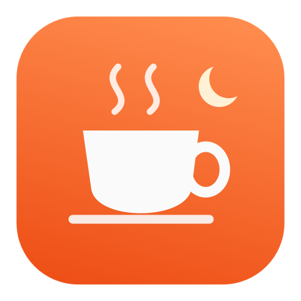

<p align="center">
  
</p>

<h1 align="center">KeepMyMacAwake</h1>

<p align="center">
  <b>让 Mac 在你离开时继续工作。</b><br>
  AI 编程、构建、下载还在跑？锁屏离开、睡一觉，甚至合上盖子，Mac 都不会睡眠；到点自动恢复正常睡眠。
</p>

<p align="center">
  <a href="https://github.com/diguike/KeepMyMacAwake/releases"></a>
  
  <a href="https://github.com/diguike/KeepMyMacAwake/actions/workflows/ci.yml"></a>
  <a href="LICENSE"></a>
</p>

<p align="center">
  <a href="https://github.com/diguike/KeepMyMacAwake/releases">下载 Mac 版</a> ·
  <a href="README.en.md">English</a> ·
  原生 macOS 菜单栏 App · 免费开源
</p>

<p align="center">
  <picture>
    <source media="(prefers-color-scheme: dark)" srcset="docs/images/overview-dark.png">
    
  </picture>
</p>

## 为什么需要它

你让 Claude Code、Codex 或 Cursor 跑一个重构、一轮长测试，或者开着一个大文件下载，然后去吃饭、开会、睡觉。回来却发现 Mac 早就睡着了，任务停在半路。

KeepMyMacAwake 把“别让 Mac 睡着”做成一个按钮：到点自动结束，Mac 恢复正常睡眠。不用记着去改系统设置，也不用开终端敲 `caffeinate`。

## 三步用起来

1. **选场景**：日常、夜间、接电合盖或外出合盖，时长和规则都能再调。
2. **点“开始”**：之后就可以锁屏离开。合盖场景第一次使用前，先按提示安装一次后台组件。
3. **到点自动结束**：Mac 恢复正常睡眠。中途想看进度、停止或延长 15 分钟，点菜单栏的杯子图标即可。

## 功能

- **一键保持唤醒**：30 分钟、1/2/8 小时、自定义 1–1440 分钟，或不限时；运行中可随时延长 15 分钟。
- **菜单栏信息面板**：剩余时间、预计结束时刻、已运行时长、电源与电量、网络、散热状态和上次结束原因，一眼看全，也能直接开始、停止或延长。
- **可以锁屏离开**：不改变锁屏规则，锁屏后任务继续运行。
- **合盖继续运行**：首次授权一次后台组件后，接电或用电池都能合盖运行。
- **三种屏幕模式**：自动关闭、常亮、调暗（夜里看进度不刺眼）。
- **自动停止保护**：拔掉电源、电量降到下限、散热状态过高、断网（可选）或读不到这些状态时自动停止。
- **可靠恢复**：合盖用的睡眠设置由独立后台组件管理，App 退出、崩溃或失联 20 秒后都会自动还原。
- **记录上次结果**：早上回来就能看到昨晚是几点、因为什么停下的。
- **本地运行**：不联网上报，不收集数据；只在本机保存你的偏好和最近一次结束记录。

### 四个场景

| 场景 | 默认设置 | 适合 |
| --- | --- | --- |
| 日常 | 1 小时，需开盖，仅接电，屏幕自动关闭 | 离开一会儿，开会、吃饭 |
| 夜间 | 8 小时，需开盖，仅接电，屏幕调暗 | 睡前开着长任务 |
| 接电合盖 | 不限时，可合盖，仅接电 | 接着电源合盖放在桌上 |
| 外出合盖 | 2 小时，可合盖，可用电池，断网即停 | 合盖带着走一段路（请保证通风） |

选好场景后，时长、屏幕和停止条件都可以再调；调过的会标“已调整”，并自动记住。

## 下载与安装

1. 打开 [Releases](https://github.com/diguike/KeepMyMacAwake/releases)，下载最新的 `KeepMyMacAwake-…-macOS-universal.dmg`（macOS 14+，Apple Silicon 和 Intel 通用）。
2. 打开 DMG，把 KeepMyMacAwake 拖进“应用程序”，然后打开它。
3. 体验版使用开发证书签名，尚未经过 Apple 公证。第一次打开如果被拦截，到“系统设置 → 隐私与安全性”点“仍要打开”（[Apple 说明](https://support.apple.com/zh-cn/102445)）。不需要关闭任何全局安全设置。
4. 要合盖运行：选“接电合盖”或“外出合盖”，点“安装后台组件”，在“系统设置 → 通用 → 登录项与扩展”中允许 KeepMyMacAwake 在后台运行，用触控 ID 或登录密码确认。看到后台组件“已连接”后再开始。

> 首次合盖前，建议先开盖设 1 分钟试一次，确认到点能正常结束。

**从旧版升级**：先在旧版“设置 → 后台组件”点“卸载后台组件…”并确认（0.2.x 为“停止并移除组件”），再用新版替换 App，打开后在合盖场景点“安装后台组件”。作者本机实测升级后原有的系统授权会保留；如果系统再次要求，请本人用触控 ID 或密码确认。

## 常见问题

**菜单栏里找不到杯子图标？**
有刘海的 MacBook 上菜单栏图标太多时，部分图标会被刘海挡住。可以退出一些不常用的菜单栏 App，或按住 ⌘ 把图标拖到靠右的位置。打开 App 时也会显示控制窗口，里面能完成全部操作。

**会影响锁屏或公司电脑的安全策略吗？**
不会。它只阻止“因闲置而睡眠”，不改锁屏规则，也不绕过企业管理限制。

**合盖安全吗？**
请放在通风的桌面上使用，不要放进包里运行。散热状态来自 macOS 系统，不是温度读数，也无法判断电脑是不是在包里。散热状态持续较高 30 秒或达到严重时会自动停止。

**它会判断 AI 任务完成了吗？**
不会。它只负责让 Mac 保持唤醒，到你设定的时间或触发保护条件时停止。任务是否成功，请看任务本身的结果。

**怎么卸载？**
先在“设置 → 后台组件”点“卸载后台组件…”并确认，成功后再把 App 移到废纸篓。保持唤醒期间不要直接删除或移动 App。

**和 caffeinate、系统设置有什么区别？**
`caffeinate` 需要终端，系统设置改了要记得改回来，而且两者都不负责合盖。KeepMyMacAwake 用图形界面完成这些事，到点自动恢复，还有电量、散热、断网保护和异常恢复。

## 当前状态

- Mac 最新体验版 [v0.5.0](https://github.com/diguike/KeepMyMacAwake/releases/tag/v0.5.0)：暖阳配色、数字为主的状态区、菜单栏信息面板。使用开发证书签名，尚未公证。
- 普通保持唤醒、到期恢复和夜间调暗都已在本机实测。作者在自用 MacBook 上反馈合盖可用；不同机型的完整合盖验收矩阵仍在进行，详见 [实际进度](docs/status.md)。
- Windows 版是同仓库的开发预览（WPF + 系统托盘，仅接电开盖），暂无公开 Release，见 [Windows 说明](windows/README.md)。

## 技术说明与边界

- 普通模式使用公开的 IOPMAssertion 阻止闲置睡眠，停止即释放。
- 合盖模式由签名的独立 helper 写入系统级 `pmset disablesleep`，带有限期租约、20 秒失联截止和持久化恢复记录；发现其他工具已启用时拒绝接管。请避免同时使用多个合盖保活工具。
- “恢复”只撤销本应用的改动，不保证 Mac 立即睡眠（其他 App 可能仍在阻止睡眠）。
- 屏幕“调暗”是临时的软件暗色遮罩，不调节硬件亮度。“已连接”表示系统有可用网络，不保证互联网或任务服务可达。

## 参与开发

<details>
<summary><b>从源码构建（Mac）</b></summary>

要求 macOS 14+、Xcode 或 Command Line Tools（Swift 5.9+）。不需要生成 Xcode 工程。

```sh
git clone https://github.com/diguike/KeepMyMacAwake.git
cd KeepMyMacAwake
swift test
./scripts/build-macos.sh
open dist/KeepMyMacAwake.app
```

默认构建是未签名的开发预览，**只能开盖使用**（界面会显示“未签名构建不支持合盖”）。合盖需要的后台组件必须用证书签名：

```sh
security find-identity -v -p codesigning
CONFIGURATION=release SIGN_IDENTITY='Apple Development: Your Name (TEAMID)' ./scripts/build-macos.sh
```

把签名版放到 `/Applications` 后再授权后台组件；首次合盖测试按 [Mac 交接清单](docs/mac-handoff.md) 操作。签名和公证见 [分发说明](docs/distribution.md)；仓库不包含任何证书或凭据。

README 展示图先由测试离屏渲染，再合成为桌面效果图：

```sh
AWAKE_SCREENSHOTS=/tmp/shots swift test --filter ScreenshotTests
swift macos/scripts/compose-overview.swift /tmp/shots/control-idle-light.png /tmp/shots/menubar-active-light.png docs/images/overview-light.png light
swift macos/scripts/compose-overview.swift /tmp/shots/control-idle-dark.png /tmp/shots/menubar-active-dark.png docs/images/overview-dark.png dark
```

</details>

<details>
<summary><b>Windows 开发预览</b></summary>

需要 .NET 10 SDK。Windows 上运行：

```powershell
dotnet build windows/KeepMyMacAwake.slnx -c Release
dotnet test windows/tests/Awake.Core.Tests.csproj -c Release
dotnet run --project windows/app-tests/Awake.App.Tests.csproj -c Release
./scripts/build-windows.ps1
```

Mac 可交叉打包 Windows ZIP 和安装器，GitHub Actions 也能生成 x64 / ARM64 预览包与界面报告，见 [Mac 双端工作流](docs/mac-windows-workflow.md) 和 [GitHub 打包说明](docs/github-windows-build.md)。预览只开放接电、开盖使用，合盖与电池能力保持关闭。

</details>

<details>
<summary><b>目录结构</b></summary>

| 目录 | 内容 |
| --- | --- |
| `macos/` | Mac App（SwiftUI + AppKit）、核心逻辑、合盖 helper、测试与打包 |
| `windows/` | Windows WPF App、核心逻辑、平台后端、受限服务源码与测试 |
| `specs/` | 两端共用的场景与行为测试数据 |
| `scripts/` | 构建、打包、发布入口 |
| `docs/` | 进度、设计、验证与决策记录 |

</details>

文档：[实际进度](docs/status.md) · [产品范围](docs/product.md) · [技术设计](docs/architecture.md) · [验证矩阵](docs/validation.md) · [设计决策](docs/decisions.md) · [体验评审](docs/ux-review.md) · [Mac 交接](docs/mac-handoff.md) · [Windows 方案](docs/windows-plan.md)

参与开发前请读 [AGENTS.md](AGENTS.md) 和 [CONTRIBUTING.md](CONTRIBUTING.md)。由 [递归客](https://github.com/diguike) 开源，[MIT 许可证](LICENSE)。觉得好用的话，欢迎点个 Star，或把它分享给同样在跑长任务的朋友。
